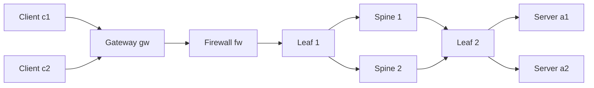

# Bàn giao hạ tầng TV1 cho TV2

Đây là mạng emulation chạy thực tế trong Ubuntu VM bằng Mininet/Open vSwitch. Workload AI inference và dashboard sẽ do TV2 triển khai trên các endpoint có sẵn; chương trình trong `tests/network_probe.py` chỉ là fixture kiểm tra TCP.

## 1. Cài đặt và chạy

Trong Ubuntu 24.04 ARM64 hoặc AMD64, dùng Python hệ thống để thấy Mininet từ APT:

```bash
git clone https://github.com/Linhlss/Nhom18_HTMMT.git
cd Nhom18_HTMMT
sudo bash scripts/setup-ubuntu.sh
python3 -m unittest discover -s tests -v
sudo /usr/bin/python3 control/networkctl.py start --profile A
sudo /usr/bin/python3 control/networkctl.py status
sudo /usr/bin/python3 control/networkctl.py verify
```

`start` trả về khi mạng đã được xác minh; tiến trình quản lý tiếp tục chạy nền. `status` và các lệnh điều khiển trả một JSON trên stdout. Mã thoát 0 là thành công, khác 0 là thất bại. Khi máy reboot, OVS/SSH khởi động lại nhưng topology cần được dựng lại bằng `start`.

Không kích hoạt venv khi chạy networkctl. Các lệnh chạy workload có thể chỉ rõ Python/venv của TV2 nếu môi trường đó đã được tạo trong guest. VM, khóa SSH, socket và runtime state được giữ cục bộ.

## 2. Topology và địa chỉ



Mũi tên chỉ thứ tự mô tả; mọi link đều hai chiều. Có **6 Linux host/namespace + 4 OVS switch = 10 node**, 10 link. Hai client kết nối vào hai interface/subnet riêng của gateway, không cần thêm switch access.

| Node | Interface và địa chỉ | Tuyến bổ sung |
|---|---|---|
| c1 | eth0: 10.18.1.10/24 | default via 10.18.1.1 |
| c2 | eth0: 10.18.2.10/24 | default via 10.18.2.1 |
| gw | eth0: 10.18.1.1/24; eth1: 10.18.2.1/24; eth2: 10.18.254.1/30 | 10.18.3.0/24 via 10.18.254.2 |
| fw | eth0: 10.18.254.2/30; eth1: 10.18.3.1/24 | 10.18.1.0/24 và 10.18.2.0/24 via 10.18.254.1 |
| a1 | eth0: 10.18.3.11/24 | default via 10.18.3.1 |
| a2 | eth0: 10.18.3.12/24 | default via 10.18.3.1 |

Tên interface thực tế có tiền tố node, ví dụ `gw-eth2`. Switch không cần IP quản trị để chuyển tiếp trong testbed.

| Switch | Port 1 | Port 2 | Port 3 | Port 4 |
|---|---|---|---|---|
| leaf1 | fw-eth1 | spine1-eth1 | spine2-eth1 | — |
| spine1 | leaf1-eth2 | leaf2-eth1 | — | — |
| spine2 | leaf1-eth3 | leaf2-eth2 | — | — |
| leaf2 | spine1-eth2 | spine2-eth2 | a1-eth0 | a2-eth0 |

Các link leaf–spine dùng 25 Mbps, delay 1 ms mỗi interface phát. Các link còn lại dùng 100 Mbps, delay 0 ms. Hàng đợi cấu hình 100 packet/interface, HTB + netem của Mininet. Giá trị `speed: 10000 Mbps` mà OVS báo cho veth là tốc độ thiết bị ảo, **không phải** capacity sau traffic shaping; kiểm tra bằng `tc` và các phép đo đã lưu.

## 3. Profile và firewall

- **A:** mọi client–server flow qua Spine 1, cả hai chiều.
- **B:** flow thuộc subnet c1 qua Spine 1; flow thuộc subnet c2 qua Spine 2, cả hai chiều. Đây là **static OpenFlow flow-splitting theo client subnet**, không phải ECMP hay chia từng packet.
- Để bài thử 2/4/8 kết nối dùng cả hai đường, TV2 phân kết nối luân phiên `c1, c2, c1, c2, ...`; một kết nối đơn từ c1 vẫn chỉ dùng Spine 1. Profile B không tự chia đều nếu mọi kết nối đều phát từ cùng một client.
- ARP luôn đi theo cây qua Spine 1. IPv4 dùng rule tường minh, table-miss drop, không dùng NORMAL/FLOOD trên vòng fabric. Cấu hình này không cung cấp tự chuyển tuyến khi spine hỏng.
- Gateway và firewall bật IPv4 forwarding trong namespace. Không NAT, giữ nguyên IP client để rule chọn đường và phép đo có thể đối chiếu.
- Firewall cho phép ICMP giữa subnet client/server và TCP client → server cổng **8000**, **5201–5208**; cho phép established/related, chặn kết nối mới ngoài danh sách. Đây là chính sách FORWARD trong namespace `fw`, không thay firewall của VM/macOS.

Preset được lưu trong `topology/configs/profile_a.json` và `profile_b.json`. Địa chỉ, link, route và công thức sinh rule nằm trong `topology/model.py`. Khi thay thiết kế phải sửa test và kiểm chứng lại trước khi dùng làm baseline.

## 4. Chạy chương trình của TV2

```bash
# Chạy ở server a1; lệnh giữ chờ tới khi chương trình kết thúc.
sudo /usr/bin/python3 control/networkctl.py exec --timeout 120 a1 -- /usr/bin/python3 workload/server.py

# Từ terminal Ubuntu khác: chạy client tại c1.
sudo /usr/bin/python3 control/networkctl.py exec --timeout 60 c1 -- /usr/bin/python3 workload/client.py
```

Hai đường dẫn workload trên là **điểm tích hợp cho TV2**, chưa phải chương trình đã có. CWD của chương trình được chạy là thư mục clone chứa networkctl. `exec` nhận argv, không tự diễn giải qua shell. JSON trả về có `success`, `returncode`, `stdout`, `stderr`; khi chương trình thất bại, networkctl cũng trả mã khác 0. Timeout tối đa 600 giây, hết hạn sẽ dừng cả nhóm tiến trình do lệnh đó tạo.

TV2 có thể dùng `subprocess.Popen` chạy nhiều lệnh `exec` đồng thời. Trong Python dùng danh sách argv và `json.loads(stdout)`; không ghép chuỗi lệnh từ input giao diện.

Chốt đặc tả workload N18-002 trước khi viết client/server: request/response size (byte), request rate (request/s và nêu mỗi flow hay tổng), concurrency, service delay (ms), thời lượng chạy, đơn vị và cách phân kết nối giữa c1/c2. Fixture TCP và iperf3 trong bộ test không thay thế đặc tả này.

## 5. Confirm, Ignore và Apply

```bash
# Bỏ qua đề xuất; profile/flow table giữ nguyên.
sudo /usr/bin/python3 control/networkctl.py apply --profile B --decision ignore --actor TV2

# Sau khi người vận hành xác nhận:
sudo /usr/bin/python3 control/networkctl.py apply --profile B --decision apply --confirm --actor TV2

# Chuyển về A theo cùng quy trình.
sudo /usr/bin/python3 control/networkctl.py apply --profile A --decision apply --confirm --actor TV2
```

Dừng workload và chờ mọi lệnh `exec` kết thúc trước khi Apply, sau đó chạy lại cùng offered load. Apply bị từ chối khi vẫn có lệnh workload đang chạy. Khi TV2 làm dashboard, chỉ truyền `--confirm` sau thao tác xác nhận thật của operator.

Runtime root-only dùng `/run/nhom18/network.sock`; không mở HTTP API hoặc cổng điều khiển ra mạng. Các request được khóa khi kiểm chứng/đổi cấu hình. Apply chỉ nhận A/B, soát lại toàn bộ rule và ping sau khi đổi. Nếu có lỗi, thao tác trả thất bại; nếu khôi phục cấu hình trước không kiểm chứng được, profile được đánh dấu `null` và cần dừng/kiểm tra lại.

Audit log tại `/run/nhom18/apply.jsonl` có session ID, timestamp UTC, actor, decision, old/new profile/hash, kết quả verify và rollback. Giá trị `actor` do operator khai báo, không phải hệ thống xác thực danh tính. Runtime nằm trong `/run`, mất sau reboot; bộ test sao chép audit log vào evidence để lưu lâu dài.

## 6. Kiểm thử và dừng

```bash
sudo /usr/bin/python3 control/networkctl.py stop
sudo /usr/bin/python3 scripts/verify-network.py --label tv2-local
```

Bộ test yêu cầu chưa có topology đang chạy, tự tạo và dọn mạng, kiểm tra A/B ba lượt, capture/counter, firewall, Ignore, Apply thiếu xác nhận, profile sai, Apply khi busy và lỗi đường đi có chủ đích. Mã thoát 0 chỉ khi các điều kiện bắt buộc đạt. Test có thể mất vài phút; negative case mất thêm thời gian chờ ping timeout.

`--quick` chỉ kiểm tra kết nối và vòng đời, phù hợp kiểm tra clone sạch; không thay thế bộ test đầy đủ. Evidence xuất vào `evidence/network/<UTC>-<label>/`. Đọc `result.json`, `exit-code.txt`, raw JSON/PCAP và source manifest; không chỉnh log để đổi kết quả.

Log tiến trình quản lý: `.local/runtime/network.log`. Nếu tên bridge/interface trùng, startup sẽ báo lỗi thay vì chạy `mn -c`. Không xóa tài nguyên của testbed khác. Khi không cần dùng, chạy `stop`; lệnh dọn đúng các tài nguyên của phiên hiện tại.

## 7. Tiêu chí TV2 nhận bàn giao

1. Clone repo, tự dựng VM đúng kiến trúc theo `docs/env-matrix.md`.
2. Setup và verify trên máy của mình, lưu log gốc.
3. Dựng profile A, chạy chương trình client/server qua `exec`, rồi kiểm chứng profile B.
4. Tích hợp Confirm/Ignore/Apply theo CLI/JSON trên, không thay đổi định nghĩa profile hoặc tải giữa hai lần so sánh.
5. Nhờ người review chạy lại; chỉ khi có lần chạy thật trên máy thành viên khác mới nghiệm thu N18-045.

Việc cài sạch trên OS mới và kiểm thử trên máy TV2 là các xác minh riêng; một bản clone sạch trên VM TV1 không chứng minh cả hai điều đó. Kết quả iperf3 là chẩn đoán hạ tầng, chưa trả lời các RQ của workload AI inference.
